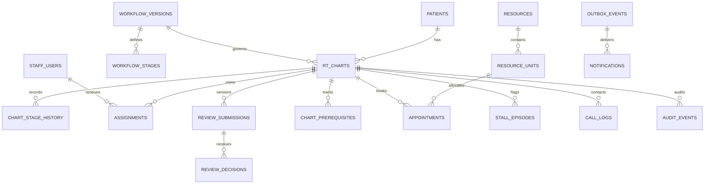

# Database design and migrations

The executable source of truth is [001_initial.sql](../../database/migrations/001_initial.sql). Target server: PostgreSQL 17 with `btree_gist`. The older numbered schema is historical chemo planning and must not be executed.

## Relationships

## Integrity rules implemented in SQL

- Unique chart display number, username and optional hospital patient number.
- A new chart requires an active approved workflow and starts at that workflow's initial stage.
- The chart's workflow version cannot be changed in place; approved definitions cannot be edited through normal DML. Retirement/migration of live charts needs a designed follow-up change.
- Composite foreign keys prevent mixing stages from different workflows or decisions from different charts.
- One active owner for a chart/task, one open stall per chart and one notification per recipient/event.
- A submission has a kind and revision; decisions reference that exact submission and require a reason for rejection.
- Positive thresholds, valid appointment intervals and basic identity-provider consistency checks.
- Resource unit bookings use half-open time ranges `[start, end)`. Reserved/confirmed bookings cannot overlap on one unit; adjacent bookings can share the end/start instant. Capacity is represented by independently bookable units.
- History, audit, review submissions and review decisions reject UPDATE, DELETE and TRUNCATE. A database owner can disable triggers; this is not a guarantee against privileged administrators.

## Application rules still required

The schema does not independently verify clinical staff competence, permission scopes, role ownership of every foreign key, appropriate transitions, booking readiness, approval invalidation, or atomic history capture. The future authenticated command service must enforce those rules. A non-null readiness snapshot is a structural requirement, not proof that all prerequisites are satisfied.

Retain decisions for old revisions. When a new revision is submitted, invalidate dependent current prerequisite facts and require the agreed review chain again. Do not mutate historical approval rows. Confirm the exact dependency rules with staff before implementing them.

Time is stored in `timestamptz`; display in Asia/Kolkata. The current threshold field is elapsed minutes; working-day/holiday calculations are not implemented. Phone number and hospital number formats remain department decisions. Operational notes have no clinical-file attachment mechanism, but free text still needs careful UI guidance and access control.

## Migration discipline

`npm run db:migrate` acquires a transaction-scoped advisory lock, checks migration SHA-256 digests, and applies pending SQL transactionally. A failed migration rolls back; editing an applied migration is rejected. Add a numbered migration instead. There is deliberately no destructive automatic down command.

`npm run db:seed` only accepts a development environment and database name ending in `_dev`. Its fixture remains DRAFT, contains no staff credentials or patients, and is repeatable while it remains draft. Do not activate this fixture for real use.

The Compose database owner is for disposable local development. Before deployment create separate migrator and application database roles. The application role must not own tables, create extensions, alter schema, update migration records or disable triggers. Grant only required DML, with INSERT/SELECT only for historical tables. A reviewed least-privilege provisioning script belongs to the operations milestone once command permissions are complete.

## Verification

`npm run test:db:embedded` executes the migration and constraint suite in an in-memory PostgreSQL-derived runtime. `npm run test:db` runs the same suite on a dedicated PostgreSQL server. Every fixture rolls back; no test points at `DATABASE_URL`. A `_test` suffix is required for the external test database.

The current suite checks schema/constraint behavior, not simultaneous independent transactions. Add real two-session booking, idempotency and stale-update tests when the corresponding commands are built. Full PostgreSQL behavior, backup/restore and load checks remain separate deployment gates.
