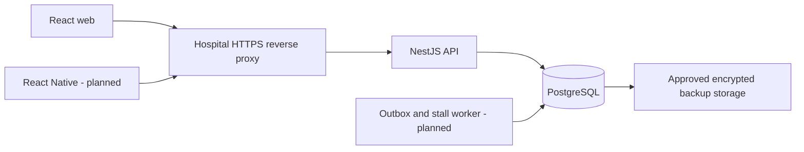

# Architecture

## Decision

Use a TypeScript workspace with a React web app, NestJS modular API, PostgreSQL and a later React Native app. The intended deployment is a hospital-owned server behind an internal TLS reverse proxy. This is a single-department modular application; introduce separately deployed services only when an operational need is demonstrated.

The checked-in Compose app profile is a localhost HTTP preview, not the illustrated production TLS deployment.

## Boundaries

| Area       | Responsibility                                                          | Current state                                                       |
| ---------- | ----------------------------------------------------------------------- | ------------------------------------------------------------------- |
| Identity   | Authenticate sessions and scope records/actions                         | Default-deny guard implemented; identity provider and login pending |
| Registry   | Patient identity and RT chart lifecycle                                 | Schema only                                                         |
| Workflow   | Authorized action, expected version, prerequisites, approved definition | Pure policy function and schema; persistence command pending        |
| Reviews    | Submission revisions and decisions                                      | Schema only                                                         |
| Scheduling | Resource capacity, readiness and booking lifecycle                      | Database overlap constraint; application commands pending           |
| Follow-up  | Stalls, calls, notifications and delivery                               | Schema only; worker pending                                         |
| Audit      | Append-only mutation record                                             | Protected tables; application capture pending                       |
| Health     | Liveness and database/schema readiness                                  | Implemented                                                         |

Keep future modules under `apps/api/src/<module>`. Controllers validate input and authenticate requests; command services enforce domain rules; repositories perform parameterized SQL. Do not let frontend state authorize changes. Shared contracts provide types and policy vocabulary, not trusted client claims.

## Mutation transaction contract

For a future state-changing command:

1. Verify the staff session and load active roles from the server.
2. Acquire/inspect the actor's idempotency record; reject key reuse with a different payload.
3. Lock the chart, verify access scope and compare the expected version.
4. Load the chart's approved workflow definition, assignment and prerequisite facts.
5. Evaluate the requested transition; rejection returns a stable code without changing data.
6. Update current state and increment version; insert history, audit, result and outbox event in the same transaction.
7. Commit, then return the saved result. Publish notifications through the outbox worker after commit.

No stage-change endpoint is exposed until this transaction service and identity are implemented. The current pure function cannot supply database locking, idempotency or authorization by itself.

## Recorded decisions

| ID      | Decision                                            | Reason                                                                                                                                 |
| ------- | --------------------------------------------------- | -------------------------------------------------------------------------------------------------------------------------------------- |
| ADR-001 | RT is the working domain                            | Later source documents correct the chemo assumption; user accepted the assessment.                                                     |
| ADR-002 | Separate patient identity and RT charts             | Repeated charts/courses must not overwrite one patient's prior history.                                                                |
| ADR-003 | Plain SQL migrations plus `pg`                      | Constraints, composite foreign keys and PostgreSQL range exclusions are directly reviewable. No ORM needed for the initial foundation. |
| ADR-004 | Draft workflow fixture, no clinical seed            | Exact 13-stage RT definition is absent; software must not silently invent it.                                                          |
| ADR-005 | Deny private API routes until authentication exists | Makes accidental endpoint exposure fail closed during development.                                                                     |
| ADR-006 | Single backend, future database outbox worker       | Fits the documented low volume and avoids losing handoff events after a process crash.                                                 |
| ADR-007 | No native scaffold or external push yet             | Distribution/signing and device data boundaries remain open; mobile stays an explicit milestone.                                       |
| ADR-008 | Embedded SQL smoke tests plus real PostgreSQL CI    | Local schema checks work without Docker, while server behavior still has a separate verification path.                                 |

## Tooling references

Runtime selection was checked against [NestJS setup](https://docs.nestjs.com/first-steps) and [Vite setup](https://vite.dev/guide/). PostgreSQL constraints are described in the [official constraint documentation](https://www.postgresql.org/docs/current/ddl-constraints.html). Embedded tests register the documented [PGlite btree_gist extension](https://pglite.dev/extensions/).

Dependencies are captured in `package-lock.json`. The `multer` override pins 2.3.0 to address the advisory reported during installation; review whether the override remains necessary when upgrading NestJS. [Advisory](https://github.com/advisories/GHSA-wc9g-mqfw-jrwm)
