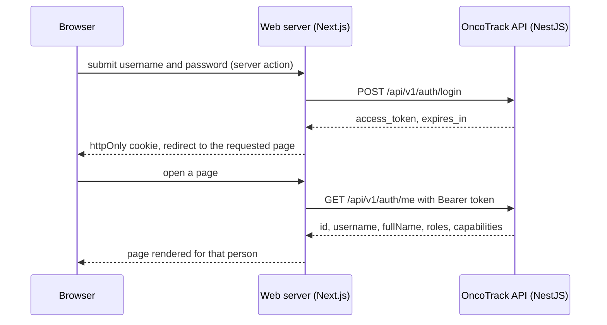

# Web application

`apps/web` is a Next.js (App Router) application written in TypeScript, started from the department's login template (`DevKit_template/nextjs-typescript-starter-kit`) and kept in REST-auth mode.

## How sign-in works

- **The browser never calls the API.** Pages and server actions call it from the web server, so `API_URL` is never sent to the browser and the API needs no CORS settings.
- **The token lives in an `httpOnly`, `SameSite=Lax` cookie.** Page scripts cannot read it. It expires when the API session does (`SESSION_TTL_HOURS`, default 12). The API stores only a SHA-256 of it.
- **Roles come from the API, never from the browser.** There is no role switcher: `GET /auth/me` returns the roles and capabilities held in the database. Screens may hide actions for convenience, but the API decides what is allowed.
- **Logout** (`POST /api/auth/clear`) first revokes the session on the API, then deletes the cookies. It deletes them even when the API cannot be reached.
- **Expired or revoked sessions** are caught by the first API call: the user is sent to `/login?redirect=…` and returns to the page they wanted.
- **No refresh tokens.** The API issues none (`AUTH_REFRESH` is `null` in `constants/api/auth.api.ts`). The template's refresh code stays, switched off and covered by tests, in case a directory sign-in (decision D-08) needs it.

## What was removed from the template

Supabase sign-in, the OIDC callback, the encryption helpers, Redux, the sample "projects" module and Google fonts (the server may have no internet access). The app uses system fonts and loads no external resources (test WEB-006).

## Settings

Copy `apps/web/.env.example` to `apps/web/.env.local` (`npm run env:init` does this for you).

| Variable                   | Meaning                                                                         |
| -------------------------- | ------------------------------------------------------------------------------- |
| `API_URL`                  | The API including its prefix, e.g. `http://127.0.0.1:3000/api/v1`. Server only. |
| `NEXT_PUBLIC_APP_NAME`     | Name shown in page titles. Default `OncoTrack`.                                 |
| `NEXT_PUBLIC_APP_URL`      | Public address of the web app. Default `http://localhost:5173`.                 |
| `TRUSTED_CLIENT_IP_HEADER` | Optional. Header a reverse proxy sets with the visitor's address.               |

An invalid value stops the server at start-up with a list of what is wrong (`instrumentation.ts`). A missing `API_URL` only logs a warning.

## Layout

| Path                  | Purpose                                                                           |
| --------------------- | --------------------------------------------------------------------------------- |
| `app/`                | Pages, server actions and route handlers                                          |
| `views/`              | Page-level components                                                             |
| `services/api/`       | The only code that calls the API (`handleRequest`, `AuthService`, `StaffService`) |
| `services/app/`       | Cookie and session storage                                                        |
| `proxy.ts`            | Sends logged-out users to login and logged-in users away from it                  |
| `constants/routes.ts` | Which pages need login (`PROTECTED_ROUTES`)                                       |
| `e2e/`                | Browser tests                                                                     |

## Tests

- `npm test -w @oncotrack/web`: unit tests (Vitest, 256 at the time of writing).
- `npm run test:e2e`: browser tests (Playwright). Project `chromium` runs against a stand-in API (`e2e/mock-api.mjs`) that copies the real responses. Project `real-api` (WEB-020) runs the same web app against the real API on an in-memory PostgreSQL with every migration applied (`e2e/real-api.mjs`). Both need `npm run build` first.
