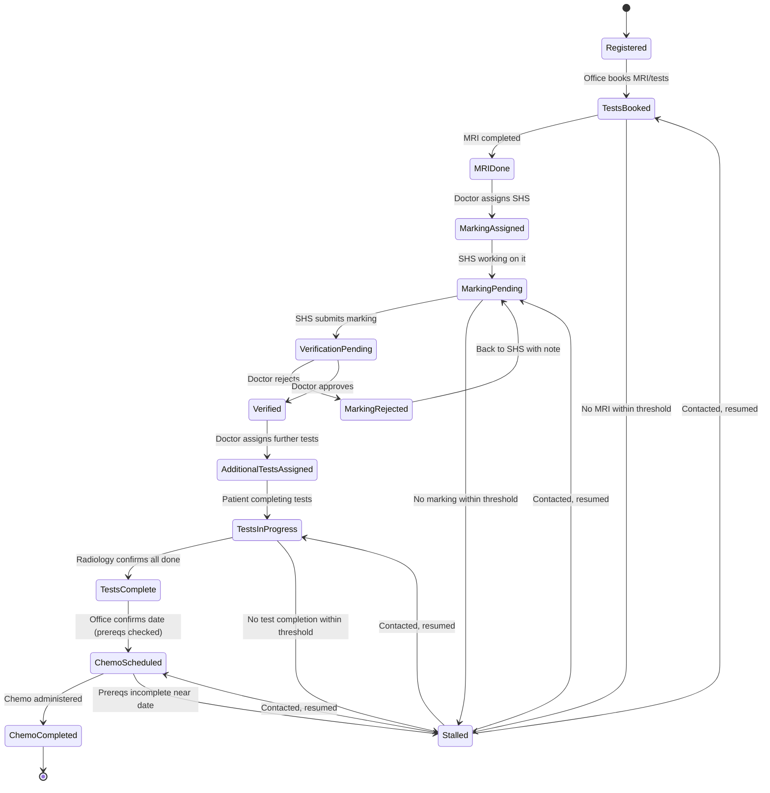

# App Workflow Document
## OncoTrack — Patient Pipeline Tracking System

**Companion to:** 01_PRD.md, 02_TRD.md

---

## 1. Patient Pipeline State Machine



**Note on "Stalled":** this is not a separate track a patient permanently moves into — it's a flag layered on top of whichever stage the patient is actually in, raised when time-in-stage exceeds the configured threshold. The diagram shows it as connected states for clarity, but in the data model (see Backend Schema) it is implemented as an `is_stalled` flag + `stalled_since` timestamp on the patient's current stage record, not a distinct stage value. This keeps "what stage is this patient really at" and "is this patient overdue" as two separate, independently answerable questions.

---

## 2. Stage Definitions and Ownership

| Stage | Meaning | Who advances it | Typical next actor |
|---|---|---|---|
| **Registered** | Patient has had initial consultation, Patient ID issued | Doctor / Office | Office (books tests) |
| **Tests Booked** | MRI/pre-chemo test slot booked | Office | Patient (attends), then Office/Radiology marks MRI Done |
| **MRI Done** | MRI completed, awaiting SHS assignment | Radiology / Office | Doctor (assigns SHS) |
| **Marking Assigned** | SHS has been assigned, hasn't started | Doctor | SHS |
| **Marking Pending** | SHS actively working on marking | SHS | SHS (submits) |
| **Verification Pending** | Marking submitted, awaiting doctor review | SHS | Doctor |
| **Marking Rejected** | Doctor sent it back with a note | Doctor | SHS (revises, resubmits) |
| **Verified** | Doctor approved the marking | Doctor | Doctor (assigns further tests) |
| **Additional Tests Assigned** | Doctor has specified what further tests patient needs | Doctor | Patient / Radiology |
| **Tests In Progress** | Patient is completing assigned tests | Radiology | Radiology (confirms completion) |
| **Tests Complete** | All prerequisite tests confirmed done | Radiology | Office (schedules chemo) |
| **Chemo Scheduled** | Date fixed; prerequisites were checked at confirmation time | Office | Office/Doctor (day-of) |
| **Chemo Completed** | Chemo administered | Doctor / Office | End of this pipeline instance (may loop for next cycle) |

**Recurring chemo cycles:** many oncology chemo regimens involve multiple cycles. v1 treats each "Chemo Scheduled → Chemo Completed" as one cycle instance; a patient can be moved back to "Chemo Scheduled" for their next cycle without re-running the full MRI/marking/verification pipeline, unless the doctor explicitly reopens that portion (e.g., a follow-up scan is due). This distinction should be confirmed with the doctor during the pilot — see PRD Open Questions.

---

## 3. Role-Based Workflow Views

### 3.1 Doctor (Admin) — daily flow
1. Opens dashboard → sees full patient list grouped by stage, with stalled patients highlighted at the top.
2. Reviews "Verification Pending" queue → approves or rejects each marking.
3. Reviews "MRI Done, unassigned" queue → assigns an available SHS.
4. Reviews stalled-patient list → decides who should be called (delegates to Office, or calls personally).
5. Reviews upcoming chemo-scheduled patients with incomplete prerequisites → intervenes if needed.

### 3.2 Senior House Surgeon — daily flow
1. Opens "My Queue" → sees patients assigned for marking.
2. Selects a patient → performs marking (offline, on imaging system — not in this app) → returns to app, taps "Mark Complete," optionally attaches a short note.
3. If a marking is rejected, it reappears in the SHS's queue with the doctor's note.

### 3.3 Radiology — daily flow
1. Opens "Tests Due" queue → sees patients scheduled for imaging/tests today, with a visible checklist of what prerequisite steps they've already completed.
2. Confirms MRI Done or Tests Complete as patients pass through.
3. Flags a patient as a no-show if they don't appear for a booked slot (feeds into stall detection).

### 3.4 Office / Front Desk — daily flow
1. Opens "Needs Attention" queue → combines stalled patients and patients with upcoming chemo dates with incomplete prerequisites.
2. Calls patients from this list (outside the app) → logs outcome in-app.
3. Manages the booking calendar → sees color-coded slots (green = prerequisites complete, yellow = pending, red = incomplete/at risk) when confirming a chemo date.

---

## 4. Cross-Department Data Sharing Flow

```mermaid
sequenceDiagram
    participant Doc as Doctor
    participant Off as Office
    participant Rad as Radiology
    participant SHS as Senior House Surgeon
    participant Sys as OncoTrack System

    Doc->>Sys: Register patient
    Sys-->>Off: Patient visible in "Tests Booked" queue
    Off->>Sys: Book MRI test
    Sys-->>Rad: Patient visible in "Tests Due" queue
    Rad->>Sys: Mark MRI Done
    Sys-->>Doc: Patient visible in "Needs SHS Assignment"
    Doc->>Sys: Assign SHS
    Sys-->>SHS: Notification: new case assigned
    SHS->>Sys: Submit marking complete
    Sys-->>Doc: Notification: verification needed
    Doc->>Sys: Verify (approve/reject)
    alt Approved
        Sys-->>Doc: Assign additional tests
        Sys-->>Rad: Patient visible in "Tests In Progress"
        Rad->>Sys: Confirm tests complete
        Sys-->>Off: Patient ready for chemo scheduling
        Off->>Sys: Confirm chemo date
        Sys->>Sys: Validate prerequisites
        Sys-->>Off: Confirmed (or warning if incomplete)
    else Rejected
        Sys-->>SHS: Notification: revise marking
    end
```

This is the core value of the system: each department only sees what's relevant to them, but every action is visible to the others without a phone call or a physical file changing hands.

---

## 5. Stall Detection Logic (plain-language)

For each active patient, the system tracks how long they've been in their current stage. Each stage has a configurable "expected duration" (set by the doctor, tunable per P1-1). If a patient exceeds that duration without advancing, they're flagged as stalled and appear on the Doctor's and Office's "Needs Attention" queues until either:
- they advance to the next stage (flag clears automatically), or
- staff logs a call outcome noting the situation is being handled (flag stays visible but is annotated, so it doesn't get silently ignored).

This is deliberately simple (duration-based) rather than trying to predict no-shows — the department can tune thresholds based on real experience during the pilot rather than the system guessing.
